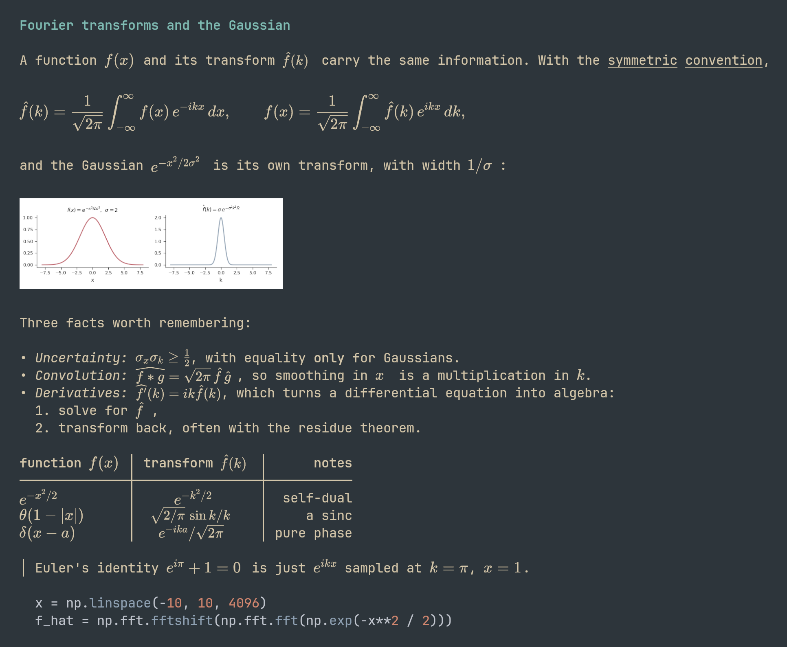

<div align="center">

# visomd

**Markdown in the terminal, with real LaTeX math.**



<sub>The same note on a light background, with <code>theme = "auto"</code>: <a href="assets/demo-light.png">assets/demo-light.png</a></sub>

</div>

`viso` renders a Markdown file in your terminal. Prose stays styled, wrapped terminal text. Every formula is typeset in-process by [RaTeX](https://github.com/erweixin/RaTeX), a KaTeX-compatible engine, and placed as a kitty graphics image through Unicode placeholders, so inline math sits on the text baseline and scrolls with its line, and display math gets rows of its own. One static binary with the fonts embedded; no TeX, Typst or font install.

- **Math that lines up.** Inline formulas share the prose's baseline and x-height. Display formulas are set in TeX display style and scaled to the width.
- **The Markdown you already write.** Headings, emphasis, inline code, links, nested and ordered lists, block quotes, rules, syntax-highlighted code blocks, and tables with aligned columns and wrapping cells. Math uses the `$...$` and `$$...$$` syntax of GitHub and pandoc.
- **Images, links and a pager.** `` on a line of its own is shown through the same kitty path, PNG as it is and JPEG re-encoded, scaled to the width. Links are OSC 8 hyperlinks, clickable in the terminal. `viso -p` pages the text through `$PAGER` while the images stay on the terminal, so they scroll with the text.
- **Light terminals too.** The background is queried, and the code theme and inline-code color follow it.
- **Nothing to install besides the binary.** KaTeX fonts and syntax definitions are compiled in; the terminal does the rest.
- **Degrades cleanly.** Without graphics support, or with `--no-images`, formulas print as LaTeX source.

Requires a terminal that implements the kitty graphics protocol with Unicode placeholders: [kitty](https://sw.kovidgoyal.net/kitty/) ≥ 0.28, [Ghostty](https://ghostty.org/), [WezTerm](https://wezterm.org/).

## Install

Every [release](https://github.com/samox73/visomd/releases) ships static Linux binaries (x86_64, aarch64) and an Apple silicon binary. Unpack the tarball and put `viso` on your `PATH`. Or build from source:

```sh
cargo install --git https://github.com/samox73/visomd --locked   # the binary is `viso`
```

## Use

```sh
viso notes.md
cat notes.md | viso
viso -p notes.md            # page through $PAGER (less -R); images stay on the terminal
viso --no-images notes.md   # LaTeX source instead of images
viso --debug-term           # what viso detects: size, cell pixels, colors, graphics, config
```

| Flag | Meaning | Default |
|:--|:--|:--|
| `--width N` | wrap width in columns | terminal width, 80 when piped |
| `--max-width N` | cap on the automatic wrap width | 100 |
| `--display-scale F` | display math size relative to inline math | 1 |
| `--fg RRGGBB` | math ink color | terminal foreground, via OSC 10 |
| `--theme NAME` | syntect theme for code blocks; `auto` picks `base16-ocean.dark` or `.light` from the background | `auto` |
| `--no-images` | print math and image files as text | off |
| `--pager`, `-p` | page the text through `$PAGER`, default `less -R`, on an alternate screen viso manages, so the view stays within the document and quitting restores the shell, like `man` (less 632 or newer; viso adds `-X`, `--max-back-scroll=0` and `--clear-screen`: kitty shows images only on the screen they were sent to, and reverse-index brings back stale ones) | off |
| `--tty` | send image transfers to `/dev/tty` instead of stdout, as `-p` does; a pager of your own must stay on the main screen and never reverse-index, e.g. `LESSUTFCHARDEF=10EEEE:p viso --tty notes.md \| less -RX --max-back-scroll=0 --clear-screen` | off |
| `--print-config` | print every config key with its effective value | |
| `--completions SHELL` | print a completion script for bash, zsh, fish or nushell | |

Shell completions come from the binary itself, and the release tarballs carry them in `completions/`. nushell autoloads `~/.local/share/nushell/vendor/autoload`, so:

```nu
viso --completions nushell | save -f ~/.local/share/nushell/vendor/autoload/viso.nu
```

## Config

`~/.config/visomd/config.toml` (or `$XDG_CONFIG_HOME/visomd/config.toml`) holds persistent settings, one `key = value` per line named like the flags. Flags override the file. `viso --print-config` prints every key with its current value, ready to paste:

```toml
max-width = 100
display-scale = 1.0
theme = "auto"
# fg = "d3c6aa"
no-images = false
pager = false
```

## How the math is sized

Inline formulas are set in TeX text style at the size where the math font's x-height matches a terminal font's, on a baseline shared with the prose. A formula that would leave its row, such as a subscript with a descender, is shifted by the missing pixels; one taller than a row is shrunk to fit. Display formulas are set in display style at the inline size (`--display-scale` changes that), at most four rows tall, scaled down to the width, left-aligned. Each formula is one image, transferred once and anchored to placeholder cells, so it wraps, scrolls and survives a resize like the text around it.

## Limitations

- Only KaTeX's command set is available: `\bra`, `\ket` and `\braket` are in, the `physics` package is not.
- Images are PNG or JPEG files; SVG, GIF and remote URLs print as links, and an image inside a sentence is a link too. Images are sent at full size, so a 12-megapixel photo is a 16 MB transfer.
- Footnotes and raw HTML are printed as text. No tmux passthrough, no sixel or iTerm2 protocols.
- The design records are in [plans/](plans/): [0.1.0](plans/closed/0.1.0.md) for the math pipeline, [0.2.0](plans/active/0.2.0.md) for images, the pager, links and light terminals.

## Development

```sh
cargo test                   # includes a snapshot of tests/fixture.md at width 60
nix shell nixpkgs#sway nixpkgs#grim nixpkgs#imagemagick -c nu assets/screenshot.nu           # re-shoot assets/demo.png in a kitty on a headless sway
nix shell nixpkgs#sway nixpkgs#grim nixpkgs#imagemagick -c nu assets/screenshot.nu --light assets/demo.md assets/demo-light.png
```

Releases are cut by tagging: bump `version` in `Cargo.toml`, commit, tag `vX.Y.Z` and push the tag. CI checks the tag against the version, builds the binaries and publishes the GitHub release.

## License

Licensed under either of [Apache License 2.0](LICENSE-APACHE) or [MIT](LICENSE-MIT), at your option.
